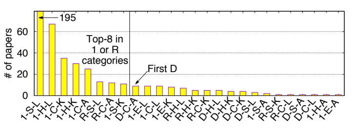
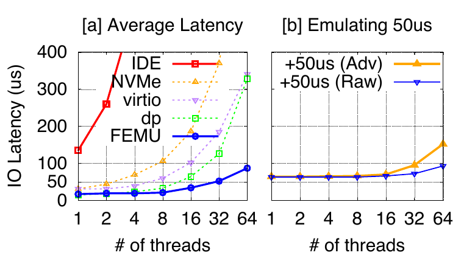
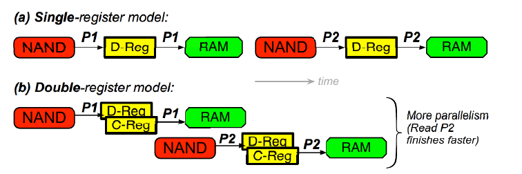
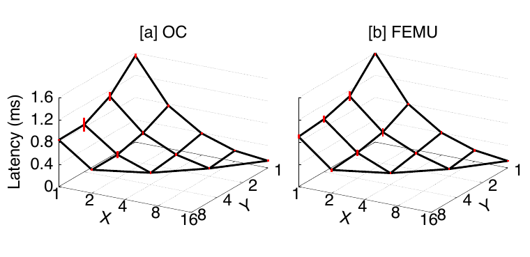
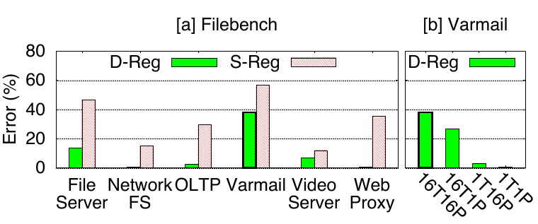
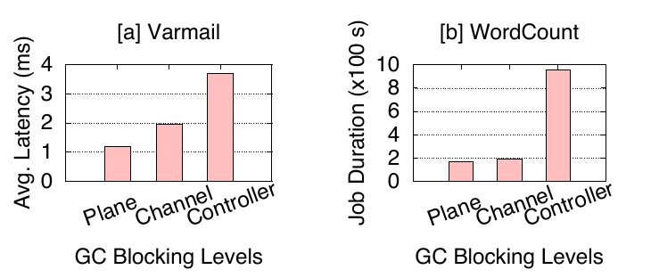

# FEMU의 CASE: Cheap, Accurate, Scalable and Extensible Flash Emulator

<!-- page: 1 -->
## 표지 · 출판 정보

원제: The CASE of FEMU: Cheap, Accurate, Scalable and Extensible Flash Emulator

저자: Huaicheng Li, Mingzhe Hao, Michael Hao Tong — 시카고대학교; Swaminatahan Sundararaman — Parallel Machines; Matias Bjørling — CNEX Labs; Haryadi S. Gunawi — 시카고대학교.

논문 페이지: https://www.usenix.org/conference/fast18/presentation/li

이 논문은 『제16회 USENIX 파일 및 스토리지 기술 학술대회 논문집』에 수록되었다. 2018년 2월 12~15일, 미국 캘리포니아주 오클랜드. ISBN 978-1-931971-42-3.

제16회 USENIX 파일 및 스토리지 기술 학술대회 논문집의 오픈 액세스는 USENIX의 후원으로 제공된다. USENIX 로고 문구: 첨단 컴퓨팅 시스템 협회(The Advanced Computing Systems Association).

> 옮긴이 주 · 읽는 방법: 이 번역은 제공된 PDF 9쪽 전체를 대상으로 한다. ‘원문 PDF 쪽 / 인쇄 쪽’ 표시와 각 단락의 ¶ 식별자는 원문과 대조하기 위한 편집 표시다. 원문의 절 번호, 인용 번호, 수치와 수식, 그림 1~6 및 참고문헌 1~47을 유지했다. 그림의 원본과 한국어 설명을 함께 싣는다. 저자명·기관명·학술지명 등 서지 식별 정보는 원어를 보존하고, 참고문헌의 제목과 출판 설명은 한국어로 옮겼다. 옮긴이 주는 모두 본문과 구분했다. 기술·프로젝트의 상태와 ‘현재’ 등의 시점 표현은 2018년 논문 발표 당시를 가리킨다.

> 옮긴이 주 · 용어 표기: CASE는 Cheap(저렴함), Accurate(정확함), Scalable(부하·병렬 규모에 대한 확장성), Extensible(기능 추가·변경의 용이성)의 머리글자다. 핵심 기술 용어는 원문과 대조하기 쉽도록 영어로 표기한다. scalability는 부하·병렬 규모를 늘리는 특성, extensibility는 기능을 추가·변경하기 쉬운 특성을 뜻한다. latency, channel, plane, register, split-level architecture 등도 본문·그림 설명·주석에서 같은 영어 표기를 사용한다.

<!-- page: 2 -->
## 논문 제목 · 저자

FEMU의 CASE: Cheap, Accurate, Scalable and Extensible Flash Emulator.

Huaicheng Li, Mingzhe Hao, Michael Hao Tong, Swaminatahan Sundararaman†, Matias Bjørling‡, Haryadi S. Gunawi. 시카고대학교; †Parallel Machines; ‡CNEX Labs.

## 초록

FEMU는 향후 software·hardware 전체 stack에 걸친 SSD 연구를 촉진하기 위한 software 기반(QEMU 기반) flash emulator다. FEMU는 저렴하고(open source로 공개), 비교적 정확하며(OpenChannel SSD를 그대로 대체해 사용할 때 0.5~38%의 차이), scalability가 있고(병렬 channel·chip 32개 지원 가능), extensibility도 갖추고 있다(SSD 내부만을 대상으로 하는 연구와 split-level 연구 지원).

## 1 서론

저렴하면서도 기능을 확장할 수 있는 연구 플랫폼은 SSD 연구가 널리 이루어지도록 하는 핵심 요소다. DiskSim의 SSD 모델[9], FlashSim[13], SSDSim[16] 같은 SSD simulator는 널리 사용되지만 SSD 내부 연구만 지원하며 kernel 수준의 확장은 지원하지 않는다. 반면 FPGA 보드[28, 34, 46], OpenSSD[7], OpenChannel SSD[11] 같은 hardware 연구 플랫폼은 software·hardware 전체 stack 연구를 지원하지만, 장치 하나당 수천 달러에 달하는 높은 비용 때문에 대규모 SSD 연구에 제약을 준다.

따라서 QEMU 기반 VSSIM[45], FlashEm[47], LightNVM의 QEMU[6] 같은 software emulator가 저렴한 대안 플랫폼으로 남는다. 안타깝게도 기존 emulator의 상황은 좋지 않다. 이들은 오래되었거나, scalability가 없거나, open source로 공개되어 있지 않다.

우리는 지금이 storage 연구 공동체에 새로운 software 기반 emulator가 절실한 시점이라고 주장한다(자세한 내용은 §2). 이를 위해 다음 네 가지 ‘CASE’ 이점을 갖춘 QEMU 기반 flash emulator FEMU를 제시한다.

첫째, FEMU는 open source software로 공개될 것이므로 저렴하다(0달러). FEMU는 이미 여러 프로젝트에서 성공적으로 사용되었으며, 그중 일부는 최상위 OS 및 storage 학술대회에 발표되었다[14, 43]. 우리는 FEMU가 더 넓은 공동체에 도움이 되기를 바란다.

둘째, FEMU는 비교적 정확하다. 예를 들어 FEMU는 OpenChannel SSD를 그대로 대체해 사용할 수 있다. 따라서 LightNVM[11]을 확장하는 향후 연구를 FEMU 위에서 수행하면서도 비교적 정확한 결과를 얻을 수 있다(예: 우리의 실험에서 0.5~38%의 차이). FEMU를 사용하면 실제 장치 없이 SSD 관련 kernel 변경의 prototype을 만들 수 있다.

셋째, FEMU는 scalability를 갖춘다. VM-exit을 수반하지 않는 interrupt와 QEMU AIO 구성 요소 우회 같은 여러 기법으로 QEMU stack을 최적화했기 때문에, FEMU는 I/O thread를 32개까지 늘려도 낮은 latency를 달성할 수 있다(2.3 GHz CPU에서 52 μs 수준). 그 결과, 의도하지 않은 queuing delay 없이 병렬 channel·chip 32개를 정확하게 emulate할 수 있다.

넷째, FEMU는 extensibility를 갖춘다. QEMU 기반 emulator이므로 FEMU는 SSD 내부 연구(FEMU 계층만 수정), software-defined flash 같은 kernel만의 연구(수정하지 않은 FEMU 위에서 Guest OS만 수정), 그리고 split-level 연구(Guest OS와 FEMU를 모두 수정)를 지원할 수 있다. 또한 다른 emulator에는 없는 여러 새로운 기능도 제공한다. 여기에는 OpenChannel 및 다중 장치·RAID 지원, NVMe 명령을 통한 확장 가능한 interface, page-level latency variability가 포함된다.

**그림 1. SSD 연구의 분류.** 이 그림은 §2.1에서 설명한다. 첫 번째 막대는 논문 195편에 해당한다. 그림 안의 ‘# of papers’는 ‘논문 수’, ‘Top-8 in 1 or R categories’는 ‘1 또는 R 범주의 상위 8개 분류’, ‘First D’는 ‘처음 등장하는 D 분류’를 뜻한다. 각 막대의 분류 코드는 아래 §2.1의 세 기준을 조합한 것이다.

## 2 추가 연구 동기

### 2.1 SSD 연구 플랫폼의 현황

우리는 지난 10년 동안 30개가 넘는 주요 시스템·storage 학술대회 및 학술지에 발표된 논문 391편을 검토하고 다음과 같이 분류했다.

1. 연구의 규모는 무엇인가? [1]: 단일 SSD; [R]: SSD의 RAID(flash array); 또는 [D]: 분산·다중 노드 SSD.

2. 어떤 플랫폼을 사용했는가? [C]: 상용 SSD; [E]: software SSD emulator(VSSIM[45] 또는 FlashEm[47]); [H]: hardware 플랫폼(FPGA 보드, OpenSSD[7], 또는 OpenChannel SSD[6]); [S]: trace 기반 simulator(DiskSim+SSD[9], FlashSim[13], SSDSim[16]).

> 옮긴이 주 · simulation과 emulation: 이 논문에서 simulator는 주로 입력 trace를 받아 SSD의 동작·시간을 모델링하는 도구이고, emulator는 실제 Guest OS와 application이 가상 SSD에 I/O를 보내며 실행될 수 있도록 장치 interface를 제공하는 도구다. ‘그대로 대체’는 해당 software stack에서 실제 장치를 가상 장치로 바꿔 쓸 수 있다는 뜻이다.

<!-- page: 3 -->
## 2.1 계속 · SSD 연구 플랫폼의 현황

3. 어떤 계층을 수정했는가? [A]: application 계층; [K]: OS kernel; [L]: 저수준 SSD controller 로직.

일부 논문은 두 하위 범주에 동시에 속할 수 있다는 점에 유의해야 한다(예: kernel과 SSD 로직을 모두 수정). 그림 1은 이들을 조합한 분류를 빈도순으로 정렬한 결과다. 예를 들어 가장 흔한 분류는 1-S-L이다. 이 분류에 속하는 논문 195편은 단일 SSD(1)만을 대상으로 simulator(S)를 사용하고 저수준 SSD controller 로직(L)을 수정한다. 그러나 simulator는 application과 OS의 실행을 지원하지 않는다.

### 2.2 대규모 SSD 연구의 부족

우리의 첫 번째 동기는 분산 SSD 범주(D-...)의 논문이 부족하다는 점이다. 예를 들어 SSD 관련 변경이 분산 컴퓨팅 및 그래프 프레임워크에 미치는 영향을 조사하는 연구가 이에 해당한다. 그럴듯한 이유 하나는 hardware 관리 비용(조달, 설치, 유지보수 등)이다. 그림 1의 상위 8개 분류에 속하는 총 324편(83%)은 단일 SSD(1-...)와 flash array(R-...)를 대상으로 한다. D 범주 중 가장 높은 순위는 D-C-A이며(그림에 강조 표시), 상용 SSD(C)를 사용하고 application 계층(A)을 수정하는 논문이 단 9편이다. 그다음 D 범주는 D-H-L로, hardware 플랫폼(H)을 사용해 SSD controller 로직(L)을 수정한다. 안타깝게도 여기에 속하는 6편의 논문 대부분은 연구 예산이 큰 대기업에서 나왔다(예: Baidu[28]와 Tencent[46]의 FPGA 사용). OpenSSD[7], OpenChannel SSD[6] 같은 다른 hardware 플랫폼도 각각 수천 달러가 들어, 특히 학계에서 simulation 이외의 다중 노드 연구를 어렵게 한다.

### 2.3 software-defined flash의 부상

오늘날 host가 관리하는 flash(‘software-defined’ 또는 ‘user-programmable’ flash라고도 함)에 관한 연구가 증가하고 있다[25, 28, 34, 35, 41, 46]. 하지만 그러한 연구는 주로 비싸고 program하기 어려운 FPGA 플랫폼 위에서 이루어진다. 최근에는 더 저렴하고 단순한 플랫폼인 OpenChannel SSD[6]가 등장했으며, Linux 기반 LightNVM[11]이 이를 관리한다. 이것이 등장한 2015년 이전에는 kernel만 변경한 논문이 24편에 불과했지만, 그 이후 11편이 발표되었다. 이는 OpenChannel SSD의 성공을 보여준다.

그러나 몇 가지 문제는 여전히 남아 있다. 첫째, 모든 학술 공동체가 이러한 장치를 살 예산을 가진 것은 아니다. 예산이 있더라도 kernel·application의 prototype을 만드는 동안 장치에 지나치게 많은 write를 발생시켜 마모시키지 않는 편이 바람직하다. 따라서 kernel prototyping 중에는 OpenChannel SSD를 software 기반 emulator로 대체하는 것이 바람직하다.

### 2.4 split-level architecture의 부상

기존 연구 대부분은 단일 계층(application·kernel·SSD)을 수정하지만, 최근의 일부 연구는 ‘split-level architecture’의 이점을 보여준다[8, 19, 24, 38, 42]. 여기서는 일부 기능이 OS kernel(K)로 올라가고 다른 기능은 SSD firmware(L)로 내려간다[18, 31, 36]. 지금까지 우리가 찾은 split-level K+L 범주(즉, kernel 계층과 SSD 로직 계층을 모두 수정)의 논문은 40편뿐이다. 대부분은 SSD controller에 접근할 수 있는 기업[19], Linux+OpenSSD[21, 32]를 사용하는 학계 연구자, 또는 block 수준 emulator(예: Linux+FlashEm)[29, 47]를 사용하는 연구자가 수행했다. OpenSSD는 single-threaded, 단일 CPU, 전체를 차단하는 GC architecture를 사용하므로 이미 알려진 중대한 제약도 많다[43]. FlashEm에도 제약이 있으며 아래에서 더 자세히 설명한다. kernel 수준의 LightNVM은 split-level 연구에 적합한 플랫폼이 아니라는 점에 유의해야 한다(즉, K는 지원하지만 L은 지원하지 않는다). SSD 계층(즉, OpenChannel SSD)을 수정할 수 없기 때문이다. OpenChannel SSD에서 white-box인 부분은 내부 channel과 chip을 노출해 software(Linux LightNVM)가 관리할 수 있도록 한다는 점이다. 하지만 OpenChannel의 firmware 로직 자체는 black-box다.

### 2.5 기존 emulator의 현황

우리가 아는 널리 사용되는 software 기반 emulator는 FlashEm, LightNVM의 QEMU, VSSIM의 세 가지뿐이다.

FlashEm[47]은 Linux block 계층에 구축된 emulator여서 이식성이 떨어진다. 특정 Linux 버전에 강하게 결합되어 있으며, 변경하려면 Linux kernel을 수정해야 한다. FlashEm은 open source로 공개되지 않았고 개발은 2년 전에 중단되었다(개발자들에게 확인한 내용).

LightNVM의 QEMU 플랫폼[6]은 아직 초기 단계다. 현재는 OpenChannel SSD처럼 여러 channel을 emulate하지 못하며, 하나의 타깃(channel 1개 뒤의 chip 1개)을 기본적으로 시험하는 데만 사용된다. 더 나쁜 점은, 수정하지 않은 기본 QEMU NVMe interface에 의존하므로 NAND latency를 emulate할 정도로 성능이 확장되지 않는다는 것이다(그림 2a의 NVMe 선 참조).

VSSIM[45]은 RAM 디스크에서 NAND flash latency를 emulate하는 QEMU/KVM 기반 플랫폼이며, 여러 논문에서 사용되었다. VSSIM의 주요 단점은 scalability가 없는 QEMU IDE interface 구현 내부에 구축되어 있다는 점이다. 그림 2a의 왼쪽 위 빨간 선(IDE 선)은 NAND delay emulation을 전혀 추가하지 않은 VSSIM에서 사용자가 체감하는 I/O read latency를 보여준다. 동시 I/O thread 수(x축)가 늘어나면 평균 I/O latency(y축)가 쉽게 몇 배로 증가한다. 예를 들어 I/O thread가 1개에서 4개로 늘어나면 평균 latency는 152 μs에서 583 μs로 급증한다. 근본 원인은 IDE에 virtualization 최적화가 지원되지 않는다는 것이다.

이러한 단점 때문에 SSD 내부 parallelism을 emulate하기가 어렵다. VSSIM은 주 I/O 경로와 분리된 QEMU의 다른 background thread에서 NAND delay만 emulate하는 방식으로 이 문제를 우회했다. 따라서 multithreaded application에서 정확한 결과를 수집하려면, 사용자는 background thread에서 emulate한 I/O latency를 관찰하는 VSSIM의 모니터링 도구[45, 그림 3]에만 의존해야 한다. 다시 말해, 사용자는… [다음 쪽에서 계속]

> 옮긴이 주 · FTL과 GC: FTL(Flash Translation Layer)은 logical address와 실제 flash 위치를 대응시키는 계층이다. GC(Garbage Collection)는 유효한 데이터를 옮긴 뒤 block을 지워 재사용할 공간을 확보하는 작업이다. split-level 연구는 이런 기능 중 일부를 OS와 장치 firmware 양쪽에서 함께 설계하는 연구를 뜻한다.

<!-- page: 4 -->
## 2.5 계속 · 기존 emulator의 현황

[앞쪽에서 계속] (IDE의 부족한 scalability 때문에) 사용자 수준에서 multithreaded application의 실행시간을 단순히 측정할 수는 없다.

이러한 제약에도 불구하고, 우리와 연구 공동체는 VSSIM 저자들에게 크게 빚지고 있다. VSSIM이 향후 QEMU 기반 SSD emulator를 위한 기본 설계를 제공했기 때문이다. 5년이 지난 지금, 기술 동향을 따라가기 위해 새로운 emulator를 만들 때가 되었다.

## 3 FEMU

이제 FEMU의 설계와 구현을 제시한다. FEMU는 QEMU v2.9에 3,929줄의 코드(LOC)로 구현되어 있으며, Guest OS에 가상 block device로 동작한다. SSD 연구를 위한 일반적인 software·hardware stack은 {application + Host OS + SSD 장치}다. FEMU를 사용하면 stack은 {application + Guest OS + FEMU}가 된다. 위 코드 줄 수에는 LightNVM의 QEMU에서 가져온 기본 OC 확장 구조와 VSSIM에서 가져온 FTL 프레임워크는 포함하지 않았다.

지면 제약 때문에 QEMU 내부에서 FEMU가 동작하는 방식의 세부 사항(예: FEMU의 FTL·GC 관리, I/O queue)은 생략한다. VSSIM 논문[45, §3]에서 유사하게 설명하기 때문이다. 이 내용은 FEMU 배포 문서[1]에 실었다. 이 논문의 나머지 부분에서는 FEMU를 설계할 때의 주요 과제, 즉 scalability(§3.1)와 accuracy(§3.2)의 달성, usability와 extensibility(§3.3)의 향상에 초점을 맞춘다.

여기에 보고하는 모든 latency는 메모리 기반 가상 storage와 2.3 GHz로 동작하는 듀얼 thread(2×) CPU 코어 24개를 사용하는 환경에서 사용자가 체감하는(application 수준의) latency이다. 실험에 따르면 평균 latency는 CPU 주파수에 반비례한다. 예를 들어 I/O thread가 1개일 때 QEMU NVMe latency는 2.3 GHz CPU에서 35 μs이고 4.0 GHz CPU에서는 23 μs다.

### 3.1 Scalability

scalability는 flash emulator의 중요한 특성이며, 특히 최신 SSD가 높은 내부 parallelism을 갖는다는 점에서 그렇다. 안타깝게도 기본 QEMU에는 scalability의 제약이 있다. 예를 들어 그림 2a와 같이 QEMU NVMe는 IDE보다 scalability가 좋지만, I/O thread가 늘어나면 평균 I/O latency가 여전히 증가한다(예: I/O thread가 8개이면 평균 I/O latency는 이미 106 μs에 이른다). 최신 SSD의 일반적인 read latency가 100 μs 미만일 수 있다는 점에서 이는 매우 바람직하지 않다.

NVMe보다 scalability가 좋은 대안으로 virtio와 dataplane(dp) interface가 있다[3, 30](그림 2a의 virtio/dp 선과 NVMe 선 비교). 하지만 이 interface들은 더 널리 쓰이는 NVMe만큼 기능을 확장하기 쉽지 않다. 그럼에도 virtio와 dp 역시 짧은 flash latency를 emulate하기에 충분한 scalability를 갖추지는 못했다. 예를 들어 I/O thread가 32개일 때 I/O latency는 각각 이미 185 μs와 126 μs에 이른다.

**문제점:** 위의 모든 scalability bottleneck은 종합하면 두 가지 원인에서 비롯된다. (1) QEMU는 I/O를 emulate하는 데 전통적인 trap-and-emulate 방식을 사용한다. Guest OS의 NVMe 드라이버는 장치 queue에 I/O가 들어 있음을 장치(우리의 경우 QEMU)에 알리기 위해 ‘doorbell을 울린다[5]’. 이 ‘doorbell’은 MMIO 연산이며, Guest OS에서 QEMU로 넘어가는 비용이 큰 VM-exit(‘world switch’[39])을 발생시킨다. I/O가 완료될 때도 유사한 연산이 필요하다. (2) QEMU는 실제 read/write(바이트 전송)를 backing image file에 수행하기 위해 asynchronous I/O(AIO)를 사용한다. 이 AIO 구성 요소는 느린 I/O(예: 디스크 이미지의 I/O)가 QEMU를 막지 않도록 하는 데 필요하다. 그러나 storage 백엔드가 RAM 기반 이미지이면 AIO overhead가 상당해진다.

**우리의 해결책:** 이러한 문제를 해결하기 위해 FEMU의 목적이 연구용 prototyping이라는 점을 활용하여 다음과 같이 수정한다.

**(1)** QEMU의 설계를 interrupt 기반에서 polling 기반으로 바꾸고, Guest OS의 doorbell write를 비활성화한다(Linux NVMe 드라이버의 코드 단 한 줄을 주석 처리). QEMU에 전용 thread를 만들어 장치 queue(Guest OS와 QEMU 사이에 매핑된 공유 메모리)의 상태를 계속 polling한다. 이렇게 하면 Guest OS는 비용이 큰 VM-exit 없이도 여전히 QEMU에 제어를 ‘넘길’ 수 있다. 뒤에서 보고하듯 FEMU는 Guest OS를 변경하지 않아도 동작한다는 점을 강조한다. 이 최적화는 선택 기능으로 볼 수 있지만, 코드 한 줄을 고치는 일은 여러 다른 kernel에서도 매우 간단하다.

**(2)** AIO 하위 구성 요소를 우회하기 위해 가상 이미지 파일을 사용하지 않는다. 대신 QEMU의 힙 공간에 자체 RAM 기반 storage를 만든다(크기를 설정할 수 있는 malloc() 사용). 그런 다음 QEMU의 DMA emulation 로직을 수정하여 이 힙 기반 storage로부터 또는 이 storage로 데이터를 전송하도록 한다… [다음 쪽에서 계속]

**그림 2. QEMU의 scalability.** QEMU의 IDE, NVMe, virtio, dataplane(dp) interface 구현과 FEMU의 scalability를 보여준다. x축은 사용자 수준에서 실행되는 동시 I/O thread 수다. 각 thread는 무작위 4 KB read I/O를 수행한다. y축은 사용자가 체감하는 평균 I/O latency이다. (a)에서 각각 VSSIM과 LightNVM의 QEMU를 나타내는 IDE 및 NVMe 선은 §2.5에서, virtio·dp·FEMU 선은 §3.1에서 설명한다. (b)의 ‘+50 μs (Raw)’ 선은 §3.2.1에서, ‘+50 μs (Adv)’ 선은 §3.2.3의 ‘결과 3’에서 설명한다. 그림의 [a] Average Latency는 ‘평균 latency’, [b] Emulating 50us는 ‘50 μs emulation’, IO Latency (us)는 ‘I/O latency(μs)’, # of threads는 ‘thread 수’, Raw는 ‘기본 구현’, Adv는 ‘advanced model’을 뜻한다.

> 옮긴이 주 · virtualization 비용: MMIO는 메모리 주소를 읽고 쓰는 방식으로 장치를 제어하는 방법이다. VM-exit은 게스트 실행에서 virtualization 계층으로 제어가 넘어가는 사건을 가리킨다. 여기서는 공유 queue를 계속 확인하는 polling으로 이러한 전환 비용을 줄인다. DMA는 장치와 메모리 사이의 직접 메모리 접근·전송을 뜻한다.

> 옮긴이 주 · 다음 절의 용어: plane은 NAND 내부에서 연산이 이루어지는 단위다. 다음 절의 모델은 channel의 데이터 전송과 plane의 read/write 작업이 어느 자원을 언제까지 점유하는지 추적한다. T_free의 ‘free’는 저장 공간이 비었다는 뜻이 아니라 해당 자원이 다음 작업을 받을 수 있게 된다는 뜻이다. ‘+=’는 기존 값에 해당 시간을 더한다는 표기다.

<!-- page: 5 -->
## 3.1 계속 · Scalability

[앞쪽에서 계속] 이 변경은 Guest OS에 투명하다(즉, Guest OS는 이 변경을 알지 못한다).

**결과:** 그림 2a의 굵은 FEMU 선은 달성한 scalability를 보여준다. I/O thread가 1~32개일 때 FEMU는 I/O latency를 52 μs 미만으로 안정적으로 유지할 수 있고, I/O thread가 64개일 때도 90 μs 미만이다. Guest OS의 코드 한 줄 최적화(VM-exit 제거)를 적용하지 않으면 thread 32개와 64개에서 평균 latency는 각각 189 μs와 264 μs다(그래프에는 표시하지 않음). 따라서 비용이 큰 VM-exit을 없애기 위해 Guest OS에서 코드 한 줄을 변경할 것을 권한다.

이제 남은 scalability bottleneck은 QEMU의 single-threaded ‘event loop’[4, 15]에서만 발생한다. 이 루프는 장치 queue에서 요청을 꺼내고, DMA emulation을 시작하고, Guest OS에 I/O 완료를 알리는 등의 주 I/O 루틴을 수행한다. 최근 연구는 큰 변경을 통해 이러한 제약을 해결했지만[10, 23], 아직 QEMU의 주 배포판에는 통합되지 않았다. FEMU의 향후 개발에서는 다른 해결책의 통합 가능성을 검토할 것이다.

### 3.2 Accuracy

이제 accuracy와 관련된 과제를 논의한다. 먼저 delay mechanism(§3.2.1)을 설명한 뒤, basic delay model과 advanced delay model(§3.2.2~3.2.3)을 설명한다.

#### 3.2.1 Delay Emulation

I/O가 도착하면 FEMU는 DMA read/write 명령을 발행한 뒤, 해당 I/O에 emulated 완료 시각(T_endio)을 붙이고 I/O 완료 시각순으로 정렬된 ‘end-io queue’에 추가한다. FEMU는 전용 ‘end-io thread’를 두어 queue의 맨 앞에서 I/O를 계속 가져오며, 해당 I/O의 emulated 완료 시각이 현재 시각을 지난 시점(T_endio > T_now)에 Guest OS로 I/O 완료 interrupt를 보낸다.

> 옮긴이 주 · 원문 수식의 부등호: 바로 위의 ‘T_endio > T_now’는 원문 표기를 그대로 보존한 것이다. 완료 예정 시각이 도래했는지 판정한다는 문맥대로라면 일반적으로 T_now ≥ T_endio일 때 완료를 통지해야 하므로, 원문의 부등호 방향은 설명과 맞지 않는 것으로 보인다. 여기서는 이를 조용히 고치지 않고 구분해 표시했다.

그림 2b의 ‘+50us (Raw)’ 선은 모든 I/O에 50 μs의 delay를 추가한 단순하고 안정적인 결과를 보여준다(T_endio = T_entry + 50 μs). Guest OS의 overhead가 약 20 μs이므로 종단 간 I/O 시간은 50 μs보다 길다는 점에 유의해야 한다. FEMU가 심각한 tail latency도 유발하지 않는다는 점이 중요하다. 위 실험에서 전체 I/O의 99%는 70 μs로 안정적이다. I/O 중 단 0.01%(99.99번째 백분위수)만 105 μs를 넘는 tail latency를 보이며, 이는 기본 QEMU에도 이미 존재하는 현상이다. 예를 들어 VSSIM에서는 99번째 백분위 latency가 이미 150 μs를 넘는다.

> 옮긴이 주 · tail latency: 평균보다 훨씬 오래 걸리는 소수의 요청에서 나타나는 delay이다. 예를 들어 99번째 백분위 latency는 요청의 99%가 그 시간 이내에 완료된다는 뜻이다. T_entry는 I/O가 들어온 시각, T_endio는 완료 예정 시각, T_now는 현재 시각을 뜻한다.

#### 3.2.2 Basic Delay Model

이제 과제는 모든 I/O의 완료 시각(T_endio)을 정확하게 계산하는 것이다. 우리는 각 plane과 channel에 다음으로 사용 가능해지는 시각(T_free)을 표시하는 basic delay model에서 시작한다. 예를 들어 현재 비어 있는 channel #1과 plane #2에 page write가 도착하면, channel의 다음 사용 가능 시각을 뒤로 미룬다(T_freeOfChannel1 = T_now + T_transfer; 여기서 T_transfer는 설정 가능한 channel상의 page transfer time이다). plane의 다음 사용 가능 시각도 뒤로 미룬다(T_freeOfPlane2 += T_write; 여기서 T_write는 설정 가능한 NAND page write/programming 시간이다). 따라서 이 write 연산의 완료 시각은 T_endio = T_freeOfPlane2가 된다.

이제 write가 진행 중일 때 같은 plane에 page read가 도착한다고 하자. 여기서는 T_freeOfPlane2를 T_read만큼 뒤로 미룬다. T_read는 설정 가능한 NAND page read 시간이다. 또한 T_freeOfChannel1을 T_transfer만큼 뒤로 미룬다. 이는 write I/O가 아니라 read 연산이므로, 이 read의 완료 시각은 T_endio = T_freeOfChannel1이다.

정리하면 이 기본 queuing model은 single-register와 uniform page latency를 가정한 모델이다. 즉, 각 plane에는 page register가 하나뿐이어서 여러 I/O를 병렬로 처리할 수 없다(plane의 T_free는 해당 plane에서 I/O가 직렬화됨을 나타낸다). NAND page의 read/write/transfer time(T_read, T_write, T_transfer)은 각각 하나의 값으로 정해진다. 또한 이 basic model에 GC 로직을 쉽게 추가할 수 있다. GC는 본질적으로 일련의 read/write 및 erase(T_erase)이며, 이들 역시 plane과 channel의 T_free를 뒤로 미루기 때문이다.

**그림 3. single-register model과 double-register model의 비교.** (a) single-register model에서 각 plane에는 data register(D-Reg)가 하나뿐이다. P1이 register 사용을 마칠 때까지(즉, controller RAM으로의 전송이 완료될 때까지) P2 page의 read를 시작할 수 없다. (b) double-register model에서는 P1을 data register로 읽은 뒤 cache register로 빠르게 복사한다(D-Reg → C-Reg). data register가 비므로 P2의 read를 시작할 수 있고(P1의 RAM 전송과 병렬로 진행), 따라서 더 빨리 완료된다. 그림의 (a)는 single-register model, (b)는 double-register model이며, time은 ‘시간’, More parallelism (Read P2 finishes faster)은 ‘parallelism 증가(P2 read가 더 빨리 완료됨)’를 뜻한다. NAND는 flash 메모리, D-Reg는 data register, C-Reg는 cache register, RAM은 controller 메모리다.

#### 3.2.3 Advanced “OC” Delay Model

위 모델은 기본적인 비교 연구(예: 서로 다른 FTL·GC 방식의 비교)에 충분하지만, 일부 연구자는 최신 hardware의 복잡한 세부 동작을 emulate하고자 할 수 있다. 아래에서는 모델을 확장해 OpenChannel SSD(이하 ‘OC’)의 delay를 더 정확하게 emulate하는 방법을 보여준다.

OC의 NAND hardware에는 다음과 같은 세부 특성이 있다. 첫째, OC는 double-register plane을 사용한다. 각 plane은 data register·cache register의 두 register로 구성되므로, plane에서의 NAND page read/write가 channel을 통해 plane으로 데이터를 전송하는 작업과 겹쳐 진행될 수 있다(즉, parallelism이 높아진다). 그림 3은 single-register model과 double-register model을 비교한다. P2 page에 대한 두 번째 I/O의 완료 시각은 double-register model에서 더 빠르다.

<!-- page: 6 -->
## 3.2.3 계속 · Advanced “OC” Delay Model

둘째, OC는 non-uniform page latency model을 사용한다. 즉, MLC 셀의 상위 비트에 매핑되는 page(upper page)는 하위 비트에 매핑되는 page(lower page)보다 latency가 길다. 예를 들어 lower/upper page read는 각각 48/64 μs이고, lower/upper page write는 각각 900/2,400 μs다. 이를 더욱 복잡하게 하는 점은 각 NAND block의 512개 page가 ‘LuLuLuLu...’처럼 균일하게 번갈아 매핑되는 것이 아니라, ‘LLLLLLuLLuLLuu...’라는 특정한 방식으로 매핑된다는 것이다. 여기서 page #0~6과 #8~9는 lower page에, #7과 #10은 upper page에 매핑되며, 나머지(‘...’)는 ‘LLuu’ 패턴이 반복된다.

**결과:** 이와 같은 상세 모델을 반영하면 FEMU는 OC를 정확하게 그대로 대체하는 장치로 동작할 수 있다. 다음 결과로 이를 보여준다.

**결과 1:** 그림 4는 OC와 FEMU의 I/O latency를 비교한다. workload는 I/O thread 16개가 storage 공간 전체에 균일하게 분포하는 무작위 read를 수행하는 것이다. 우리는 storage 공간을 서로 다른 구성에 매핑한다. 예를 들어 x = 1, y = 1은 OC와 FEMU를 channel 1개, channel당 plane 1개로만 구성했음을 뜻한다. 따라서 16개의 동시 read가 모두 같은 plane과 channel을 놓고 경쟁하므로 평균 latency가 높다(z > 1,550 μs). x = 16, y = 1의 결과는 channel 16개와 channel당 plane 1개(총 plane 16개)를 사용했음을 뜻한다. 여기서는 모든 plane과 channel이 동시 read를 병렬로 받아 처리하므로 평균 read latency가 짧다(z < 130 μs). 전체적으로 그림 4a와 4b는 매우 유사한 양상을 보이며, 이는 queuing delay emulation이 성공적임을 보여준다. latency 차이(오차)는 0.8~11.6%에 불과하다. Error = (Lat_femu − Lat_oc) / Lat_oc.

**그림 4. OpenChannel SSD(OC)와 FEMU의 비교.** X: channel 수, Y: channel당 plane 수. 이 그림들은 §3.2.3의 ‘결과 1’에서 설명한다. [a] OC는 실제 OC 장치, [b] FEMU는 FEMU 결과이며, 세로축은 latency(ms)다.

**결과 2:** 그림 5a는 filebench의 여섯 가지 workload 유형(personality)으로 여러 macrobenchmark를 실행한 결과다. channel 4개에 걸친 plane 16개에서 I/O thread 16개가 read/write를 동시에 수행한다. 그림은 latency 차이(Error)만 나타내며, 이를 통해 basic delay model과 advanced delay model의 accuracy를 비교한다. basic model의 latency는 상당히 부정확하지만(12~57%), advanced model을 사용하면 오차가 0.5~38%로 줄어든다. 이는 여섯 benchmark 전반에서 accuracy가 1.5~40배 높아진 것이다.

우리는 수십 μs 단위의 delay를 emulate한다는 점에서 이러한 오차가 합리적이라고 생각한다. 추가 최적화는 향후 과제로 남긴다. advanced model에 반영해야 할 OC의 다른 세부 특성을 놓쳤을 가능성이 있기 때문이다(§2.4 끝에서 설명했듯 OC는 channel과 chip만 노출하며, 그 밖의 세부 사항은 공급업체가 공개하지 않는다). 그럼에도 그림 5b와 같이 남은 오차를 더 조사한다. 여기서는 varmail workload 유형을 사용하되 I/O thread 수[T]와 plane 수[P]를 바꾼다. 예를 들어 plane 16개에 thread 16개를 사용하는 구성(그림 5b에서 x = ‘16T16P’, 그림 5a 실험과 같은 구성)의 오차는 38%다. 그러나 덜 복잡한 구성에서는 오차가 감소한다(예: plane 1개·thread 1개에서 0.7% 오차). 따라서 더 큰 오차는 더 복잡한 구성(예: 더 많은 I/O thread와 plane)에서 발생하며, 다음에서 이를 설명한다.

**그림 5. OpenChannel SSD(OC)와 FEMU에서의 Filebench 비교.** 이 그림들은 §3.2.3의 ‘결과 2’에서 설명한다. y축은 OC와 FEMU의 benchmark 결과 사이의 latency 차이(오차)를 나타낸다(Error = (Lat_femu − Lat_oc) / Lat_oc). D-Reg와 S-Reg는 각각 advanced model과 basic model을 나타낸다. (a)와 (b)에서 테두리가 굵은 두 막대는 동일한 실험 및 구성(plane 16개에서 thread 16개로 실행한 varmail)을 가리킨다. Error (%)는 ‘오차(%)’다. [a]의 여섯 유형은 File Server(파일 서버), Network FS(네트워크 파일시스템), OLTP(온라인 transaction 처리), Varmail(메일 처리), Video Server(비디오 서버), Web Proxy(웹 프록시)다. [b]의 구성은 16T16P, 16T1P, 1T16P, 1T1P이며, T는 thread 수, P는 plane 수다.

**결과 3:** 우리는 advanced model을 사용하면 CPU 연산량이 늘어나며, thread 수가 증가할수록 이 연산 overhead가 누적된다는 사실을 발견했다. 이를 보여주기 위해 그림 2b는 기본 구현(§3.2.1)에서 단순히 +50 μs를 추가한 delay emulation과 advanced model을 비교한다. 두 경우 모두 단순히 +50 μs를 추가하지만, advanced model은 register·plane·channel의 다음 사용 가능 시각을 확인하기 위해 많은 if-else 문을 거쳐야 하므로 연산 overhead가 생긴다. §3.1 끝에서 논의한 추가 scalability 최적화가 도움이 될 수 있다.

> 옮긴이 주 · page와 오차: 여기서 ‘page’는 이 문서의 쪽이 아니라 NAND의 데이터 단위다. MLC는 한 셀에 여러 비트를 저장하는 방식이며, upper/lower page의 접근 시간은 같지 않을 수 있다. 위 Error 식의 Lat_femu와 Lat_oc는 각각 FEMU와 OC의 latency이다. 퍼센트로 표시할 때는 식의 비율에 100을 곱한다. L/u 문자열은 원문대로 보존했다. 원문의 예시 문자열은 첫 u 앞에 L이 6개지만, 이어지는 page #0~6 설명은 lower page 7개를 뜻해 서로 일치하지 않는다. 두 표기를 모두 원문대로 유지했다.

### 3.3 Usability and Extensibility

software 기반 emulation 플랫폼인 FEMU는 여러 방식으로 확장할 수 있다. 이제 FEMU의 기존 기능과 활용 방식을 설명하고, 최근 연구[14, 43]에서 사용한 성공적인 확장 사례 및 FEMU의 기능이 가능하게 할 향후 연구를 간략히 소개한다.

<!-- page: 7 -->
## 3.3 계속 · Usability and Extensibility

**그림 6. 활용 예시.** 그림 6a는 §3.3의 ‘FTL 및 GC 방식’ 항목에서 설명한다. 그림 6b는 §3.3의 ‘분산 SSD’ 항목에서 논의한다. [a] Varmail의 y축 Avg. Latency (ms)는 ‘평균 latency(ms)’, [b] WordCount의 y축 Job Duration (x100 s)는 ‘작업 소요시간(100초 단위)’을 뜻한다. 두 그래프의 x축 GC Blocking Levels는 ‘GC blocking level’이며, Plane·Channel·Controller는 각각 ‘plane·channel·controller’를 뜻한다.

**• FTL 및 GC 방식:** 기본 모드에서 우리의 FTL은 다른 simulator[9, 16]에서 사용하는 dynamic mapping과 channel-blocking GC를 채택한다. 우리의 프로젝트 하나는 FEMU로 controller·channel·plane 차단이라는 서로 다른 GC 방식을 비교한다[43]. controller-blocking GC에서는 GC 연산이 controller를 ‘잠가’ 모든 foreground I/O의 처리를 막는다(OpenSSD[7]와 같은 방식). channel-blocking GC에서는 GC의 page 이동에 관여하는 channel만 차단된다(SSDSim[16]과 같은 방식). 가장 효율적인 plane-blocking GC에서는 어떤 channel도 사용하지 않고 page가 plane 내부에서만 이동한다(즉, ‘copyback’[2]). 결과 예시는 그림 6a에 나와 있다. 우리의 연구 외에도 최근 연구들은 performance isolation을 위한 SSD 분할의 이점을 보여주며[11, 17, 22, 27, 37], 이 연구들은 simulator나 hardware 플랫폼에서 수행되었다. FEMU로 더 많은 분할 방식을 탐구할 수도 있다.

**• white-box 모드와 black-box 모드:** FEMU는 (1) 장치가 physical page address를 노출하고 Linux LightNVM처럼 OS가 FTL을 관리하는 OpenChannel SSD 같은 white-box 장치로 사용하거나, (2) FTL이 FEMU 내부에 있고 OS에는 logical address만 노출하는 상용 SSD 같은 black-box 장치로 사용할 수 있다.

**• flash array 연구를 위한 다중 장치 지원:** FEMU는 Guest OS에 여러 장치로 보이도록 설정할 수 있다. 예를 들어 FEMU가 SSD 4개를 노출하면, FEMU 내부에는 channel이 서로 겹치지 않는 별도의 NVMe 인스턴스와 FTL 구조가 각각 4개 있고 하나의 QEMU 인스턴스에서 관리된다. 기존 emulator인 VSSIM과 LightNVM의 QEMU는 이를 지원하지 않는다.

**• 확장 가능한 OS-SSD NVMe 명령:** FEMU는 NVMe를 지원하므로, OS에서 SSD로 보내는 새로운 명령을 추가할 수 있다(예: host-aware SSD 관리 또는 split-level architecture[31]). 예를 들어 현재 LightNVM의 GC 연산은 OC의 유효한 page를 host DRAM으로 읽어 들인 다음 다시 OC로 쓴다. 이는 host와 SSD 사이의 PCIe bandwidth를 낭비하며, GC가 수행되면 LightNVM의 foreground throughput은 50% 감소한다. LightNVM 개발자들과의 대화에 따르면 OS에서 FEMU/OC로 보내는 새로운 ‘pageMove fromAddr toAddr’ NVMe 명령을 추가해, 데이터 이동이 PCIe interface를 가로지르지 않게 할 수 있다. 앞서 언급했듯 split-level architecture는 증가하는 추세이며[12, 20, 29, 40, 44], NVMe를 사용하는 FEMU는 transaction, deduplication, multi-stream 같은 더 많은 명령을 지원하도록 확장할 수 있다.

**• page-level latency variability:** 앞서 논의했듯(§3.2) FEMU는 page-level latency variability를 지원한다. SSD 엔지니어 사이에서는 ‘모든 chip이 같지는 않다’는 사실이 알려져 있다. 전체 품질이 기준을 통과하는 한, 고품질 chip과 그보다 품질이 낮은 chip을 혼합한다. 품질이 나쁜 chip은 더 많은 오류를 유발할 수 있으며, 이를 처리하려면 서로 다른 전압으로 더 오래 반복해서 읽어야 한다. FEMU는 이런 delay도 emulate하도록 확장할 수 있다.

**• 분산 SSD:** 여러 FEMU 인스턴스를 여러 머신에 쉽게 배치할 수 있으며(Linux hypervisor KVM들을 실행하는 것만큼 간단하다), 이는 더 많은 대규모 SSD 연구를 촉진한다. 예를 들어 우리는 FEMU를 실행하는 머신 클러스터에서 Hadoop의 wordcount workload 성능을 평가할 수도 있었으며, 그림 6b와 같이 서로 다른 GC 방식을 적용했다. HDFS는 큰 I/O를 사용하고, 이러한 I/O는 결국 여러 channel·plane에 걸쳐 striping되므로 channel 차단과 plane 차단 사이의 성능 차이가 더 작다. FEMU가 SSD 계층을 수정해 분산 컴퓨팅 프레임워크(예: 분산 그래프 처리 프레임워크)를 가속하는 더 많은 연구를 촉진하기를 바란다.

**• page-level fault injection:** 성능 관련 연구 외에도 flash 신뢰성 연구[26, 33]에서 FEMU를 활용할 수 있다(예: page-level의 data corruption과 결함을 주입하고 상위 software stack이 어떻게 반응하는지 관찰).

**• 제약:** FEMU는 DRAM 기반이므로 대용량 SSD를 emulate할 수 없다. 또한 hard reboot은 DRAM의 데이터를 지우므로, crash consistency 연구에서는 FEMU 사용자가 ‘soft crash’를 수동으로 emulate해야 한다. 앞서 언급했듯(§3.2) accuracy를 더 개선할 여지도 있다.

> 옮긴이 주 · foreground I/O와 차단 범위: foreground I/O는 사용자의 실제 요청을 뜻하며, 공간 회수 같은 background 작업과 구분한다. GC가 controller 전체를 막느냐, channel만 막느냐, plane에 한정되느냐에 따라 사용자 요청이 기다리는 범위가 달라진다. striping은 하나의 큰 요청 데이터를 여러 channel·plane에 나누어 배치·처리하는 것이다.

## 4 결론 및 감사의 글

최신 SSD의 내부 구조가 점점 복잡해짐에 따라 그것이 전체 storage stack에 미치는 영향을 조사해야 한다. 이러한 맥락에서 우리는 FEMU가 적합한 연구 플랫폼이라고 생각한다. 저렴하고 기능을 확장할 수 있는 FEMU가 향후 SSD 연구를 가속하기를 바란다.

담당 셰퍼드인 Sam H. Noh와 익명의 심사위원들이 보내 준 많은 피드백에 감사한다. 본 연구는 NSF의 지원을 받았다(연구비 번호 CNS-1526304 및 CNS-1405959).

<!-- page: 8 -->
## 참고문헌 · [1]~[26]

> 옮긴이 주 · 참고문헌: 저자명, 고유명, URL, 발표 연도와 권·호는 원문대로 유지했다. 각 항목의 제목과 학술대회·학술지 설명을 한국어로 옮겼다. 원문의 [15] 저자 표기는 이름 배열이 불규칙하지만 이를 임의로 재구성하지 않았다. 학술대회·프로젝트의 식별을 돕기 위해 약어를 유지했다.

[1] https://github.com/ucare-uchicago/femu.

[2] 「NAND flash 장치에서 data integrity를 유지하기 위한 COPYBACK 연산의 사용」. https://www.micron.com/~/media/documents/products/technical-note/nand-flash/tn2941_idm_copyback.pdf, 2008.

[3] 「QEMU의 multithreaded 장치 emulation을 향하여」. KVM Forum, 2014.

[4] 「QEMU event loop 개선」. KVM Forum, 2015.

[5] 「NVMe 명세 1.3」. http://www.nvmexpress.org, 2017.

[6] 「Open-Channel 솔리드 스테이트 드라이브」. http://lightnvm.io, 2017.

[7] 「OpenSSD 프로젝트」. http://openssd.io, 2017.

[8] Violin Memory. 「All-Flash Array Architecture」, 2017.

[9] Nitin Agrawal, Vijayan Prabhakaran, Ted Wobber, John D. Davis, Mark Manasse, Rina Panigrahy. 「SSD 성능을 위한 설계상의 절충」. USENIX 연례 기술 학술대회(ATC) 논문집, 2008.

[10] Muli Ben-Yehuda, Michael Factor, Eran Rom, Avishay Traeger, Eran Borovik, Ben-Ami Yassour. 「낮은 overhead의 virtualization을 통한 고급 storage controller 기능의 추가」. 제10회 USENIX 파일 및 스토리지 기술 심포지엄(FAST) 논문집, 2012.

[11] Matias Bjørling, Javier González, Philippe Bonnet. 「LightNVM: Linux Open-Channel SSD 서브시스템」. 제15회 USENIX 파일 및 스토리지 기술 심포지엄(FAST) 논문집, 2017.

[12] Tzi-cker Chiueh, Weafon Tsao, Hou-Chiang Sun, Ting-Fang Chien, An-Nan Chang, Cheng-Ding Chen. 「software가 조율하는 flash array」. 제7회 연례 국제 시스템 및 스토리지 학술대회(SYSTOR), 2014.

[13] Aayush Gupta, Youngjae Kim, Bhuvan Urgaonkar. 「DFTL: page-level 주소 매핑의 수요 기반 선택적 캐싱을 사용하는 Flash Translation Layer」. 제14회 프로그래밍 언어 및 운영체제를 위한 아키텍처 지원 국제 학술대회(ASPLOS) 논문집, 2009.

[14] Mingzhe Hao, Huaicheng Li, Michael Hao Tong, Chrisma Pakha, Riza O. Suminto, Cesar A. Stuardo, Andrew A. Chien, Haryadi S. Gunawi. 「MittOS: 빠른 거절을 수행하는 SLO 인지형 OS interface로 밀리초 단위 tail latency 내성 지원」. 제26회 ACM 운영체제 원리 심포지엄(SOSP) 논문집, 2017.

[15] Nadav Har’El, Nadav, Gordon, Abel, Landau, Alex, Ben-Yehuda, Muli, Traeger, Avishay, Ladelsky, Razya. 「효율적이고 scalability가 뛰어난 paravirtual I/O 시스템」. 2013 USENIX 연례 기술 학술대회(ATC) 논문집, 2013.

[16] Yang Hu, Hong Jiang, Dan Feng, Lei Tian, Hao Luo, Shuping Zhang. 「고급 명령, 할당 전략 및 데이터 세분성을 통한 SSD parallelism의 성능 영향과 상호작용」. 제25회 국제 슈퍼컴퓨팅 학술대회(ICS) 논문집, 2011.

[17] Jian Huang, Anirudh Badam, Laura Caulfield, Suman Nath, Sudipta Sengupta, Bikash Sharma, Moinuddin K. Qureshi. 「FlashBlox: virtualized SSD에서 performance isolation과 균일한 수명을 함께 달성하기」. 제15회 USENIX 파일 및 스토리지 기술 심포지엄(FAST) 논문집, 2017.

[18] Xavier Jimenez, David Novo. 「Wear Unleveling: page 내구성의 균형을 맞추어 NAND flash 수명 개선」. 제12회 USENIX 파일 및 스토리지 기술 심포지엄(FAST) 논문집, 2014.

[19] William K. Josephson, Lars A. Bongo, David Flynn, Fusion-io, Kai Li. 「DFS: virtualized flash storage를 위한 파일시스템」. 제8회 USENIX 파일 및 스토리지 기술 심포지엄(FAST) 논문집, 2010.

[20] Jeong-Uk Kang, Jeeseok Hyun, Hyunjoo Maeng, Sangyeun Cho. 「multi-stream 솔리드 스테이트 드라이브」. 제6회 스토리지 및 파일시스템 최신 주제 워크숍(HotStorage), 2014.

[21] Woon-Hak Kang, Sang-Won Lee, Bongki Moon, Gi-Hwan Oh, Changwoo Min. 「X-FTL: SQLite 데이터베이스를 위한 transactional FTL」. 2013 ACM SIGMOD 데이터 관리 국제 학술대회(SIGMOD) 논문집, 2013.

[22] Jaeho Kim, Donghee Lee, Sam H. Noh. 「OPS 격리를 통해 SLO를 준수하는 SSD를 향하여」. 제13회 USENIX 파일 및 스토리지 기술 심포지엄(FAST) 논문집, 2015.

[23] Tae Yong Kim, Dong Hyun Kang, Dongwoo Lee, Young Ik Eom. 「다중 queue SSD와 I/O virtualization 프레임워크 사이의 의미적 간극을 메워 성능 개선」. 제31회 IEEE 대용량 스토리지 시스템 및 기술 심포지엄(MSST) 논문집, 2015.

[24] Ana Klimovic, Heiner Litz, Christos Kozyrakis. 「ReFlex: 원격 flash ≈ 로컬 flash」. 제22회 프로그래밍 언어 및 운영체제를 위한 아키텍처 지원 국제 학술대회(ASPLOS) 논문집, 2017.

[25] Sungjin Lee, Ming Liu, Sang Woo Jun, Shuotao Xu, Jihong Kim, Arvind. 「application이 관리하는 flash」. 제14회 USENIX 파일 및 스토리지 기술 심포지엄(FAST) 논문집, 2016.

[26] Justin Meza, Qiang Wu, Sanjeev Kumar, Onur Mutlu. 「실제 운영 환경에서 발생하는 flash 메모리 고장에 관한 대규모 연구」. 2015 ACM 컴퓨터 시스템 측정 및 모델링 국제 학술대회(SIGMETRICS) 논문집, 2015.

<!-- page: 9 -->
## 참고문헌 계속 · [27]~[47]

[27] Mihir Nanavati, Jake Wires, Andrew Warfield. 「Decibel: 분리형 랙 규모 storage의 격리와 공유」. 제13회 네트워크 시스템 설계 및 구현 심포지엄(NSDI) 논문집, 2017.

[28] Jian Ouyang, Shiding Lin, Song Jiang, Zhenyu Hou, Yong Wang, Yuanzheng Wang. 「SDF: 웹 규모 인터넷 storage 시스템을 위한 software-defined flash」. 제18회 프로그래밍 언어 및 운영체제를 위한 아키텍처 지원 국제 학술대회(ASPLOS) 논문집, 2014.

[29] Vijayan Prabhakaran, Thomas L. Rodeheffer, Lidong Zhou. 「Transactional Flash」. 제8회 운영체제 설계 및 구현 심포지엄(OSDI) 논문집, 2008.

[30] Rusty Russell. 「virtio: 가상 I/O 장치의 사실상 표준을 향하여」. ACM SIGOPS 운영체제 리뷰(OSR), 2008.

[31] Mohit Saxena, Michael M. Swift, Yiying Zhang. 「FlashTier: 경량이며 일관성과 영속성을 갖춘 storage cache」. 2012 EuroSys 학술대회(EuroSys) 논문집, 2012.

[32] Mohit Saxena, Yiying Zhang, Michael M. Swift, Andrea C. Arpaci Dusseau, Remzi H. Arpaci Dusseau. 「현실로 옮기기: 연구 simulation을 hardware 시스템으로 전환하면서 얻은 교훈」. 제11회 USENIX 파일 및 스토리지 기술 심포지엄(FAST) 논문집, 2013.

[33] Bianca Schroeder, Raghav Lagisetty, Arif Merchant. 「운영 환경의 flash 신뢰성: 예상한 것과 예상하지 못한 것」. 제14회 USENIX 파일 및 스토리지 기술 심포지엄(FAST) 논문집, 2016.

[34] Sudharsan Seshadri, Mark Gahagan, Sundaram Bhaskaran, Trevor Bunker, Arup De, Yanqin Jin, Yang Liu, Steven Swanson. 「Willow: user-programmable SSD」. 제11회 운영체제 설계 및 구현 심포지엄(OSDI) 논문집, 2014.

[35] Zhaoyan Shen, Feng Chen, Yichen Jia, Zili Shao. 「DIDACache: flash 기반 키-값 캐싱을 위한 장치와 application의 긴밀한 통합」. 제15회 USENIX 파일 및 스토리지 기술 심포지엄(FAST) 논문집, 2017.

[36] Liang Shi, Kaijie Wu, Mengying Zhao, Chun Jason Xue, Duo Liu, Edwin H.-M. Sha. 「flash 메모리 storage 시스템의 수명 개선을 위한 Retention Trimming」. IEEE 집적회로 및 시스템의 컴퓨터 지원 설계 트랜잭션(TCAD), 35권 1호, 2016년 1월.

[37] Dimitris Skourtis, Dimitris Achlioptas, Noah Watkins, Carlos Maltzahn, Scott Brandt. 「Flash on Rails: 중복성을 통해 일관된 flash 성능 달성」. 2014 USENIX 연례 기술 학술대회(ATC) 논문집, 2014.

[38] Sriram Subramanian, Swaminathan Sundararaman, Nisha Talagala, Andrea C. Arpaci-Dusseau, Remzi H. Arpaci-Dusseau. 「ioSnap을 이용한 flash에서의 스냅샷 생성」. 2014 EuroSys 학술대회(EuroSys) 논문집, 2014.

[39] Jeremy Sugerman, Ganesh Venkitachalam, Beng-Hong Lim. 「VMware Workstation의 host형 virtual machine 모니터에서 I/O 장치 virtualization」. USENIX 연례 기술 학술대회(USENIX) 논문집, 2001.

[40] Animesh Trivedi, Nikolas loannou, Bernard Metzler, Patrick Stuedi, Jonas Pfefferle, Ioannis Koltsidas, Kornilios Kourtis, Thomas R. Gross. 「FlashNet: flash·네트워크 stack의 공동 설계」. 제10회 연례 국제 시스템 및 스토리지 학술대회(SYSTOR), 2017.

[41] Peng Wang, Guangyu Sun, Song Jiang, Jian Ouyang, Shiding Lin, Chen Zhang, Jason Cong. 「Open-Channel SSD에서 LSM 트리 기반 키-값 저장소의 효율적인 설계와 구현」. 2014 EuroSys 학술대회(EuroSys) 논문집, 2014.

[42] Zev Weiss, Sriram Subramanian, Swaminathan Sundararaman, Nisha Talagala, Andrea C. Arpaci-Dusseau, Remzi H. Arpaci-Dusseau. 「ANViL: 최신 비휘발성 메모리 장치를 위한 고급 virtualization」. 제13회 USENIX 파일 및 스토리지 기술 심포지엄(FAST) 논문집, 2015.

[43] Shiqin Yan, Huaicheng Li, Mingzhe Hao, Michael Hao Tong, Swaminathan Sundararaman, Andrew A. Chien, Haryadi S. Gunawi. 「Tiny-Tail Flash: NAND SSD에서 garbage collection tail latency의 거의 완전한 제거」. 제15회 USENIX 파일 및 스토리지 기술 심포지엄(FAST) 논문집, 2017.

[44] Jingpei Yang, Rajinikanth Pandurangan, Changho Choi, Vijay Balakrishnan. 「AutoStream: multi-stream SSD를 위한 자동 스트림 관리」. 제10회 연례 국제 시스템 및 스토리지 학술대회(SYSTOR), 2017.

[45] Jinsoo Yoo, Youjip Won, Joongwoo Hwang, Sooyong Kang, Jongmoo Choi, Sungroh Yoon, Jaehyuk Cha. 「VSSIM: virtual machine 기반 SSD simulator」. 제29회 IEEE 대용량 스토리지 시스템 및 기술 심포지엄(MSST) 논문집, 2013.

[46] Jianquan Zhang, Dan Feng, Jianlin Gao, Wei Tong, Jingning Liu, Yu Hua, Yang Gao, Caihua Fang, Wen Xia, Feiling Fu, Yaqing Li. 「Tencent의 대규모 storage 시스템을 위한 application-aware software-defined SSD 방식」. 제22회 IEEE 병렬 및 분산 시스템 국제 학술대회(ICPADS) 논문집, 2016.

[47] Yiying Zhang, Leo Prasath Arulraj, Andrea C. Arpaci-Dusseau, Remzi H. Arpaci-Dusseau. 「Nameless Writes를 이용한 flash 기반 SSD의 간접 참조 제거」. 제10회 USENIX 파일 및 스토리지 기술 심포지엄(FAST) 논문집, 2012.

> 옮긴이 주 · 반복 머리말·꼬리말: 원문 인쇄 쪽 83~90에는 ‘USENIX Association’ 및 ‘16th USENIX Conference on File and Storage Technologies’가 반복된다. 각각 ‘USENIX 협회’, ‘제16회 USENIX 파일 및 스토리지 기술 학술대회’다. 이 반복 정보는 번역본의 쪽 대응 표시에 반영했다.
